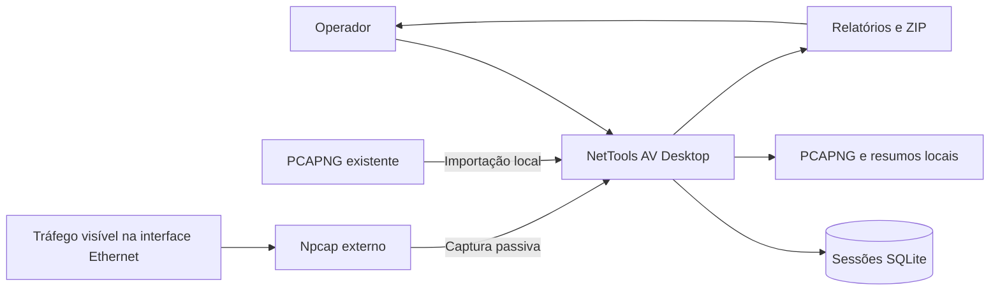
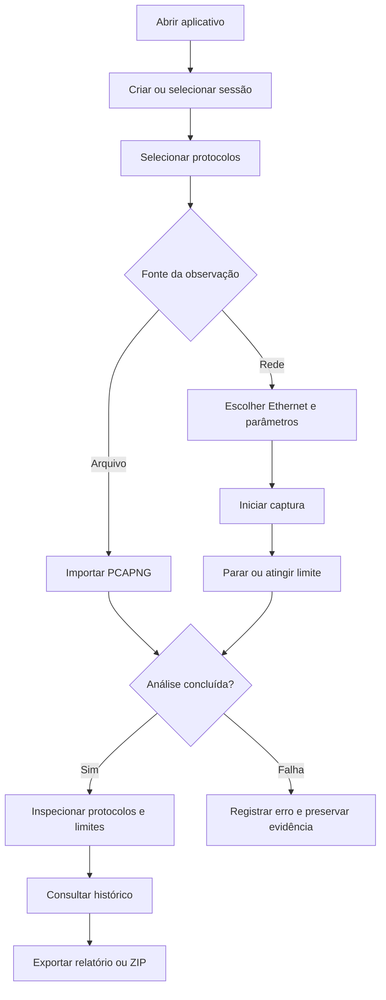
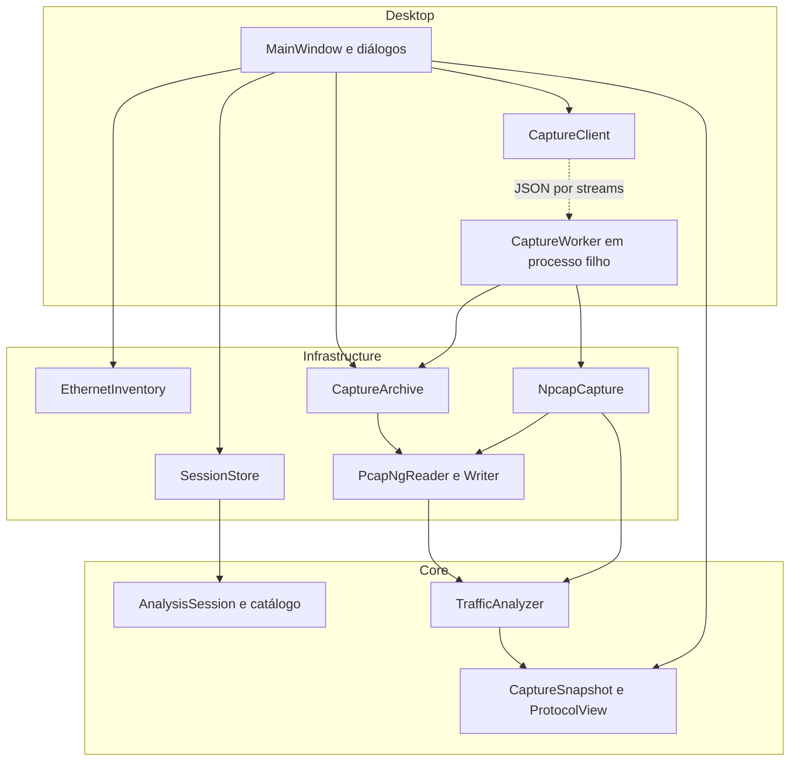
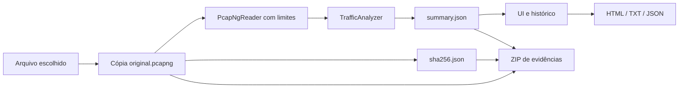
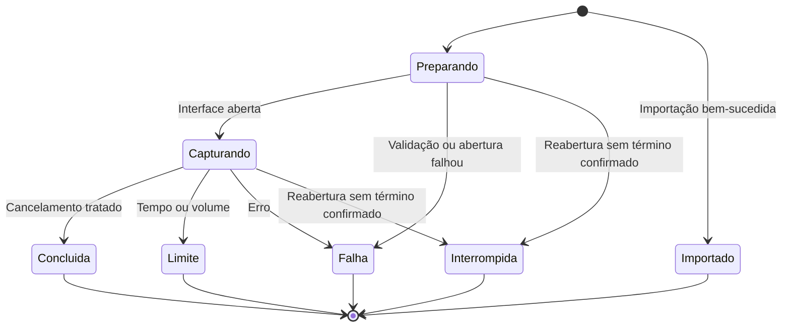
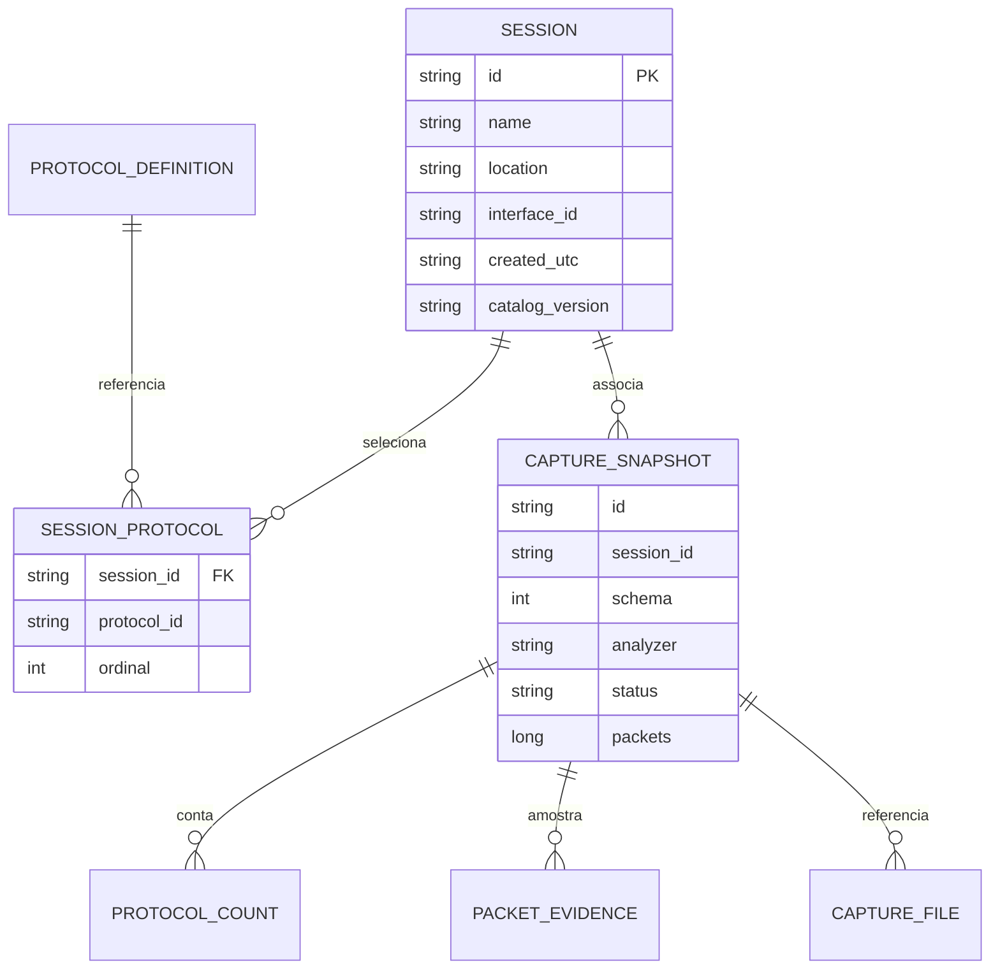
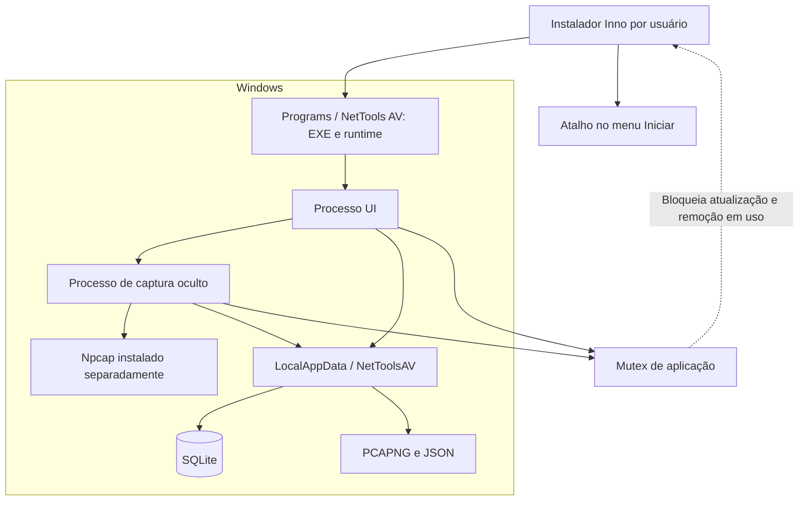
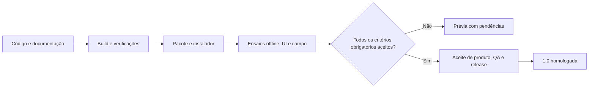

# Diagramas funcionais e técnicos

Baseline 0.2.0-preview.2. Mermaid editável; visualize em renderizador compatível. Diagramas representam o código atual, salvo seção explicitamente planejada. Fontes: MainWindow, CaptureWorker, NpcapCapture, SessionStore e CaptureArchive.

## Contexto funcional



Sem transmissão ativa de teste, nuvem ou inventário de equipamento neste fluxo.

## Fluxo do usuário



## Componentes e dependências



## Sequência da captura

```mermaid
sequenceDiagram
    actor Operador
    participant UI as Desktop / CaptureClient
    participant Host as CaptureWorker
    participant Driver as Npcap
    participant Disco as Arquivos locais
    Operador->>UI: Selecionar interface e iniciar
    UI->>Host: Iniciar EXE --capture-worker
    UI->>Host: CaptureRequest em stdin
    Host->>Driver: Validar filtro e GUID; abrir Ethernet
    loop Enquanto há tempo, espaço e não cancelado
      Host->>Driver: pcap_next_ex não bloqueante
      Driver-->>Host: Pacote ou ausência temporária
      Host->>Disco: Gravar PCAPNG e resumo periódico
      Host-->>UI: Snapshot JSON em stdout
    end
    Operador->>UI: Parar (ou limite automático)
    UI->>Host: EOF stdin quando solicitado
    Host->>Disco: Finalizar arquivo, hashes e resumo
    Host-->>UI: Snapshot terminal e término
```

Erros podem terminar o fluxo antes do loop. Se a parada solicitada exceder 5 s, o cliente pode matar o host; não é uma conclusão normal. Hash/último resumo podem ficar incompletos em falha abrupta.

## Importação e exportação



Relatório não inclui necessariamente todos os bytes dos pacotes; ZIP preserva os arquivos de evidência.

## Estados de execução



Rótulos reais: `Concluída`, `Limite atingido`, `Interrompida`. Interrompida é classificação de leitura de resumo antigo. Não confundir estado de execução com presença/estado de análise do protocolo.

## Modelo de dados



Modelo lógico: somente SESSION e SESSION_PROTOCOL são tabelas SQLite. Definições estão em código; snapshots/contagens/evidências em JSON, arquivos no disco. As associações JSON não são FKs do banco.

## Implantação



## Liberação planejada



Esta última figura é o processo exigido de liberação; a etapa 1.0 ainda não ocorreu.
