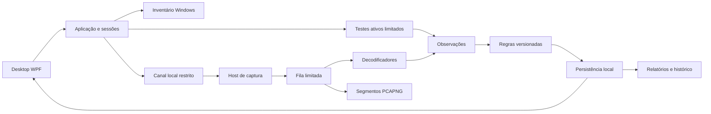

> **Documento histórico de planejamento.** Para o estado implementado e validado em 0.2.0-preview.2, consulte [documentação vigente](../README.md) e [matriz atual](14-matriz-0.2-e-homologacao.md). Propostas abaixo não constituem implementação ou homologação.

> **Atualização de escopo 0.2:** protocolos são a raiz do produto. Trechos centrados em equipamentos foram substituídos pela [revisão vigente](11-escopo-por-protocolos.md). Equipamentos permanecem apenas como recursos de laboratório.

# Arquitetura proposta e estrutura futura

Revisão 0.1 • 01/10/2026 • Desenho anterior ao código

## Fluxo principal

O diagrama representa responsabilidades, não uma obrigação de criar um processo por caixa. A proposta inicial tem desktop e host de captura separado; inventário, orquestração, análise e persistência podem iniciar como módulos do processo sem privilégio. Importação malformada não deve alcançar o processo privilegiado.

O host abre a captura e expõe somente operações delimitadas. Ele não interpreta protocolos proprietários, não executa comandos arbitrários nem permite gravação em caminhos livres enviados pelo cliente. Preferir host sob demanda; Windows Service só será adotado se PV-03 demonstrar necessidade operacional. A morte do desktop encerra a sessão do host por vínculo de vida/lease com prazo definido, a validar.

## Estrutura planejada

As pastas abaixo são apenas uma proposta documentada. Ainda não existem projetos compiláveis.

| Caminho futuro | Responsabilidade | Dependências permitidas |
|---|---|---|
| `src/NetToolsAV.Desktop` | Telas, MVVM, composição | Application e contratos |
| `src/NetToolsAV.Domain` | Estados, entidades e invariantes | Biblioteca padrão; nenhuma UI/driver |
| `src/NetToolsAV.Application` | Sessões, agendamento e casos de uso | Domain e interfaces de infraestrutura |
| `src/NetToolsAV.Windows` | Inventário, rotas, ICMP e sockets | APIs Windows por adaptadores |
| `src/NetToolsAV.Capture` | Adaptador SharpPcap/Npcap | Contratos de captura |
| `src/NetToolsAV.CaptureHost` | Processo e autorização local | Capture e contratos IPC |
| `src/NetToolsAV.Protocols` | Parsers com entradas limitadas | Domain e modelos de pacote |
| `src/NetToolsAV.Diagnostics` | Regras e correlação | Observações estruturadas |
| `src/NetToolsAV.Persistence` | SQLite, migrações e retenção | Contratos de repositório |
| `src/NetToolsAV.Reporting` | Snapshot, relatório e exportação | Contratos de leitura |
| `tests/` | Unidade, integração, replay, robustez | Projetos testados e fixtures sintéticas |
| `lab/` | Topologias, procedimentos e manifestos públicos | Sem segredos/capturas de clientes |
| `profiles/` | Perfis e regras versionados | Esquemas a definir |
| `docs/` | Engenharia, operação, decisões e provas | Documentação |

Agente remoto e adaptadores de switches serão acrescentados nas fases correspondentes. Não criar uma plataforma de plugins dinâmica antes de existir necessidade; módulos inicialmente compilados reduzem superfícies de falha.

## Contrato de resultado

Todo resultado terá identificador, RF/teste, projeto, local, sessão, ponto de medição, alvo, método, protocolo, início/fim UTC, fuso para exibição, duração monotônica, estado, motivo, valores/unidades, versões e referências de evidência. Campos desconhecidos serão nulos acompanhados de motivo, não zero inventado.

Registrar separadamente interface solicitada, endereço de origem escolhido, snapshot da rota, interface efetivamente comprovada e método dessa comprovação. GUID identifica o adaptador persistido; índice/LUID são resolvidos novamente na sessão. Não reutilizar cegamente índice depois de reconexão.

Observação é um fato de teste/captura. Diagnóstico é uma regra aplicada a observações, com hipótese e limitação explícitas. Reanálise gera novo resultado ligado ao anterior. Estados de diagnóstico: validado, atenção, falha, não observado, inconclusivo, não executado. Estados de execução — agendado, executando, cancelado, concluído — são distintos.

Captura registra interface, filtro, snaplen, timestamp e sua resolução/origem, tamanho original/capturado, descartes disponíveis por camada e janela efetivamente observada. Estatística indisponível não será representada como zero. Evidência inclui arquivo/segmento, hash após fechamento, interface da seção PCAPNG, número ou offset do pacote e condição de retenção.

## Origem dos testes

Proposta: consultar a rota com GetBestRoute2, escolher origem explícita para ICMP com IcmpSendEcho2Ex e vincular sockets TCP/UDP ao endereço e à interface quando aplicável. Multicast tem configuração própria. Essas APIs sustentam a proposta, mas a garantia do produto depende de PV-02 com captura externa. [Rota](https://learn.microsoft.com/en-us/windows/win32/api/netioapi/nf-netioapi-getbestroute2), [ICMP](https://learn.microsoft.com/en-us/windows/win32/api/icmpapi/nf-icmpapi-icmpsendecho2ex), [Sockets](https://learn.microsoft.com/en-us/windows/win32/winsock/ipproto-ip-socket-options)

Se não for possível provar a origem exigida, o teste não pode ser atribuído à Ethernet escolhida. Mudanças de link/endereço/rota invalidam o contexto e exigem nova verificação. Não alterar rotas do Windows como atalho. Resolução de nomes do sistema, caso usada, será identificada como método do host; consulta DNS vinculada à interface será uma operação distinta.

## Concorrência e limites iniciais

Propor limite global de 20 sondas/s, 20 operações ativas e no máximo uma pendente por alvo; distribuir 100 alvos ao longo do ciclo de 5 s. Timeout inicial de 1 s. Traceroute e consultas de serviços compartilham o orçamento; atraso de agendamento deve ser informado, não contado como ausência de resposta do equipamento. Retries consomem orçamento.

Captura usa filas limitadas por bytes e itens. Valor inicial experimental: orçamento agregado de 64 MiB para buffers de captura/análise; ajustar em PV-03. Nenhum produtor pode esperar indefinidamente pela UI. Quando uma fila perder itens, registrar quantidade e intervalo afetado; métricas associadas tornam-se degradadas. Priorizar parada, persistência de eventos de perda e liberação de handles.

Atualizar painéis com agregados, e não um evento visual por pacote. Cancelamento interrompe novos envios em até 2 s; operações nativas em andamento respeitam seu timeout e conservam buffers até o término seguro.

## Persistência e retenção

Modelo lógico: Projeto → Local → Sessão → Teste/Observação/Resultado/Evento; Sessão também referencia InterfaceSnapshot, CaptureSegment e VersionSet. Perfis são snapshots por sessão para que alterações futuras não modifiquem relatórios antigos.

Banco guarda metadados e agregados; bytes de captura ficam em arquivos segmentados. Um gravador serializa alterações críticas; leitores usam snapshots consistentes. Exportação congela a revisão consultada e inclui um manifesto de versões e hashes. Não copiar somente o arquivo principal de um banco ativo como estratégia de backup.

O limite circular de 2 GB do escopo precisa coexistir com rastreabilidade: antes de sobrescrever segmento, marcar referências como evidência bruta expirada, preservando resultado e motivo. Segmentos fixados para uma prova não podem ser apagados silenciosamente; ao faltar espaço, suspender gravação e informar. O pacote de evidências de um aceite deve ser preservado fora da rotação.

## Segurança operacional

IPC candidato: named pipes locais com ACL explícita, identidade do usuário validada, mensagens versionadas e tamanho máximo. Cliente remoto ou não autorizado deve ser recusado. Não depender das permissões padrão do canal. [Microsoft](https://learn.microsoft.com/en-us/windows/win32/ipc/named-pipe-security-and-access-rights)

Credenciais de integrações futuras ficam referenciadas por identificador e protegidas pelo Windows, com DPAPI no contexto adequado como candidata. O usuário deverá poder reconfigurá-las ao restaurar em outra máquina; backup não deve pressupor descriptografia portátil. [Proteção de dados](https://learn.microsoft.com/en-us/dotnet/standard/security/how-to-use-data-protection)

Capturas e arquivos importados são entradas não confiáveis: validar comprimentos antes de alocar, limitar recursão/reassemblagem, escapar conteúdo em relatórios e restringir caminhos de extração. Logs não incluem payload integral por padrão. Exportação mostra o conteúdo técnico incluído e permite omitir capturas; não promete anonimização automática.

